# Kids Smart Display

A full-screen, touch-first dashboard for kids, built for a **Raspberry Pi 5**
and the **official 7" touchscreen (800×480)**. Each morning it answers what the
kids want to know: *What's the weather? Is there school today? What should I
wear?* In the evening it looks ahead to tomorrow. Each kid has an animal
buddy dressed for the weather, and there's a daily dinosaur, joke, word, math
puzzle and fun fact. It also watches for severe weather alerts and dims or
switches off the screen when nobody's around. A PIN-locked **Grown-ups** tab
handles the settings on the screen itself (or from a phone): notes for the
kids, new quotes and facts to approve, names and buddies, weather place by ZIP code, school calendar, bedtime,
Wi-Fi, date & time, updates, restart and power off.

It's a **SvelteKit** app shown in **Chromium kiosk mode** inside the **cage**
Wayland compositor, so no desktop environment is needed. Everything is big,
colourful, sticker-styled and works with fat fingers; no mouse or keyboard.

| | |
|---|---|
| 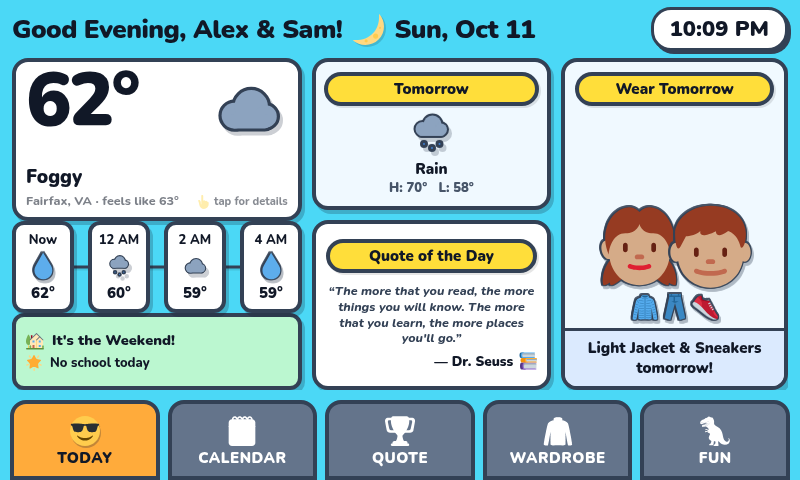 | 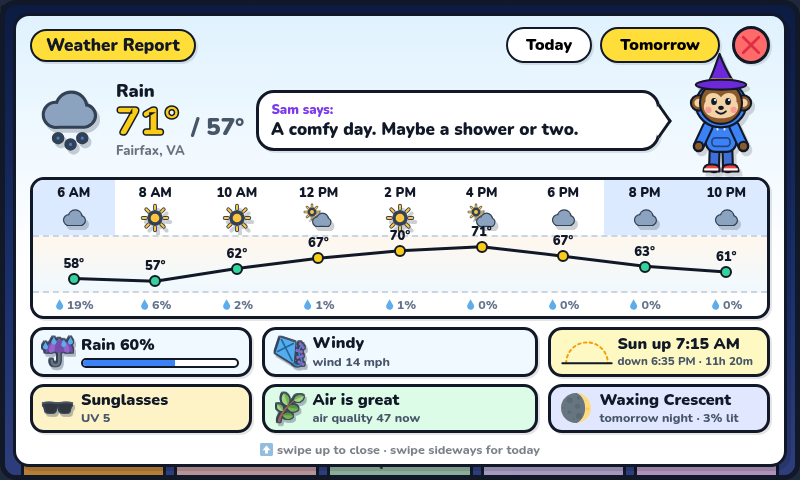 |
| 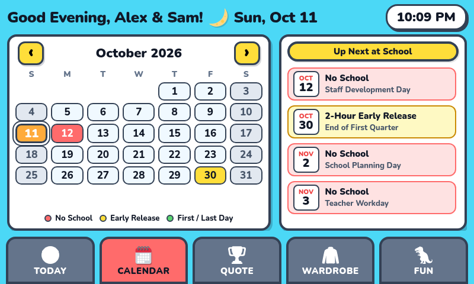 | 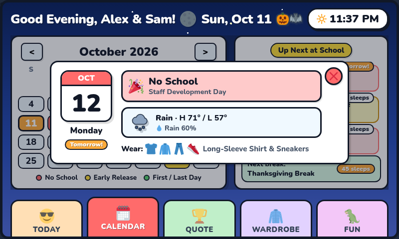 |
| 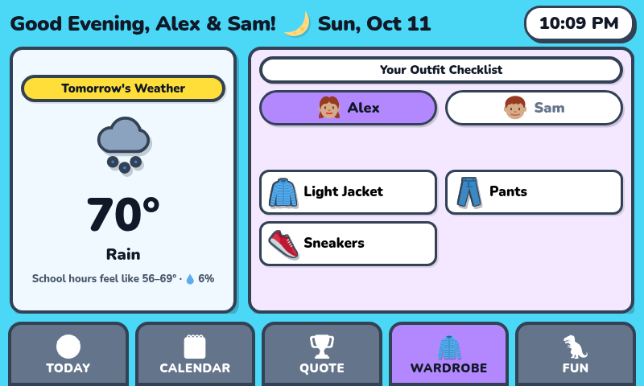 | 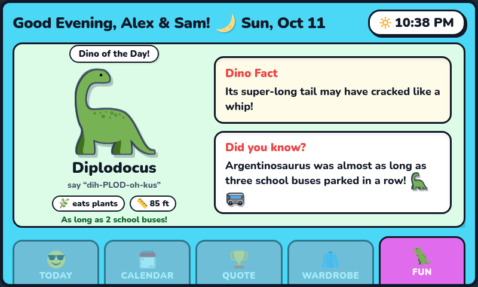 |
| 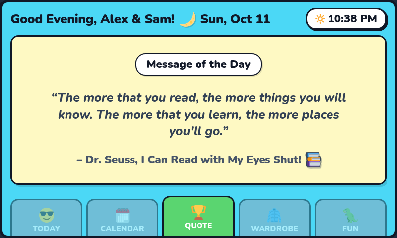 | 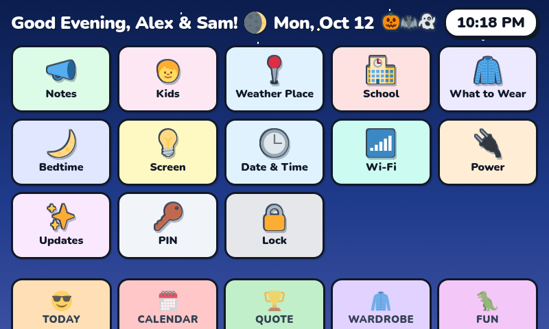 |
| 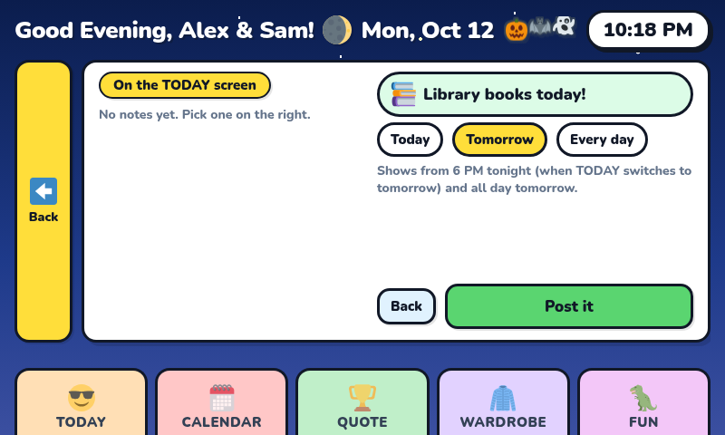 | 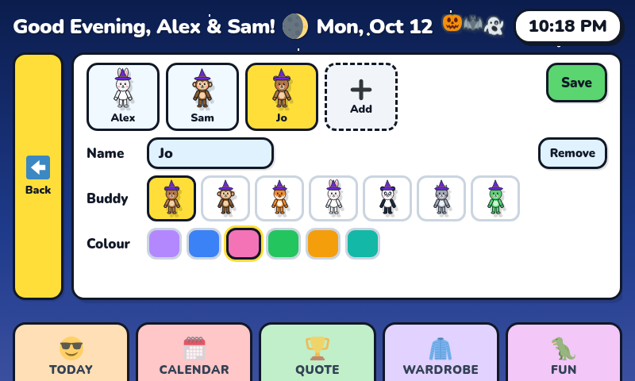 |

*Screenshots use the example config (Alex & Sam), taken on an October evening:
night sky, Halloween decorations and witch hats.*

## Hardware

- Raspberry Pi 5 (a Pi 4 should work too) running Raspberry Pi OS Lite (64-bit)
- Official Raspberry Pi 7" DSI touchscreen (800×480)
- Optional: a momentary push button on the GPIO header (see [Top button](#top-button))
- Network access for weather and the school calendar (it keeps working
  offline on the last data it downloaded)

## Quick start

```sh
git clone https://github.com/ksawant17/kids-smart-display.git kids-smart-dashboard
cd kids-smart-dashboard
npm ci
cp config/dashboard.example.json config/dashboard.json   # then edit: kids, location, school feed
npm run build
PORT=3000 node build/index.js                             # open http://<pi>:3000
```

Requires **Node.js 22+**. `config/dashboard.json` is git-ignored, so your
kids' names and location never end up in the repo. Without it, the example
config is used. To run it full-screen on the Pi at boot, see
[Running on the Pi](#running-on-the-pi).

## The five tabs

| Tab        | What it does |
|------------|--------------|
| **TODAY**  | Three big answers, one column each, every column a button: **Weather** (temperature, a kid-language sentence, the next hours, tomorrow at a glance; tap or swipe down for the full report), **School** (today's status, the next school event with a "sleeps" countdown; tap for that day in CALENDAR) and **What to Wear** (each kid's animal buddy dressed in the outfit, the outfit icons, and each kid's progress from the WARDROBE checklist; tap for WARDROBE). The top strip shows the quote of the day (tap for QUOTE), a red **weather alert** when there is one, or a **note from a grown-up** (Grown-ups tab). **From 6 PM all three columns switch to tomorrow together** under a "Getting ready for tomorrow" ribbon, so the screen never mixes days |
| **CALENDAR** | School month grid (red = no school, yellow = early release, green = first/last day, grey = weekend), swipe or ‹ › to change month, **Today** to jump back. **Tap any day** (or an Up Next row) for a popup with that day's school status, events (with break dates), and, within the week's forecast, the weather and what to wear. Plus "Up Next at School" with **"Tomorrow!" / "N sleeps" countdowns** (breaks under way stay listed until they end) and a **next-break countdown**. **Marathi calendar (पंचांग):** the lunar months and Shaka year under the month name, each day's tithi (शु ५ / व १२, a moon on Purnima / Amavasya) and a sticker on festival days; the day popup gives the full panchang ("आश्विन वद्य अमावास्या · शके १९४८") and the day's festivals; the **सण** switch on the right lists the Marathi festivals coming up |
| **WARDROBE** | Outfit planner for **today and the next 6 days** (‹ › arrows; opens on today, or tomorrow after 6 PM): the day's weather + a tap-to-check checklist **per kid**, saved per date. The kid's buddy **gets dressed as each item is ticked off** |
| **QUOTE**  | Message of the day: one encouraging, correctly attributed quote (100 built in, plus any a grown-up kept from the internet), rotates at midnight |
| **FUN**    | Five corners, each with a daily pick and an "another!" button: 🦖 **Dino** (how to say it, diet, size, era, fact) · 😂 **Joke** told by a kid's buddy, tap "Tell me!" for the punchline · 🔤 **Word of the day** (picture, pronunciation, meaning, sentence) · ➕ **Math** (Easy / Tricky, tap an answer to check it) · 💡 **Facts** |

The **full weather report** (on TODAY) is a slide-down card. A kid's animal
buddy (the kids take turns) "reports" the day, dressed for it, with a speech
bubble in kid language ("Chilly morning, warm afternoon. Rain likely after
lunch. Grab your umbrella!"). Below that, the hours appear as a **temperature
hill**: coloured dots from blue (cold) to red (hot), night hours shaded, and the
rain chance under each hour. Today shows the coming hours, Tomorrow 6 AM to 10 PM.
Fun tiles show a rain meter, wind in words (Calm / Breezy / Windy), the sun's arc
with sunrise, sunset and daylight, sun safety from the UV index, **air quality**
(US AQI) and **the moon** that night. Open it by
swiping down on the hero or tapping the hero or tomorrow card. Switch days with
the pills or a sideways swipe; close by swiping up, tapping ✕, or tapping
outside the card.
(URL shortcut for debugging: `http://<pi>:3000/?wx`, `?wx&d=1` for tomorrow.)

### Kiosk behaviour

- **Always fresh, never reloaded:** weather refreshes every
  `weather.refreshMinutes`; the date, quote, fact, dino, school banner and
  calendar roll over at midnight; config and the school calendar are re-read
  every hour.
- **Weather outages:** if Open-Meteo is unreachable the last good forecast is
  shown ("updated 7:40 AM") and the kiosk keeps retrying every minute.
- **Idle return:** after `kiosk.idleReturnSeconds` without a touch, the screen
  closes the weather report and goes back to TODAY.
- **Idle screen:** at the same moment (unless turned off with
  `kiosk.idleScreen`) the whole frame becomes the sky outside, following the
  live forecast: bright blue with a glowing sun, drifting clouds, rain, snow,
  fog, a storm flash, or stars and tonight's real moon phase at night. On top: a big clock, the
  date, the weather now with today's high/low, school today (tomorrow in the
  evening), tomorrow's forecast or "rain around 3 PM", tonight's moon and a
  grown-up's note. In festival season a banner counts down ("Diwali in 3
  sleeps!", then "Happy Diwali!") above a festive garland. On the day itself
  trim is strung across the top: a toran of marigolds and mango leaves for
  Marathi festivals, bunting in the day's colours (Holi, Independence Day,
  July 4th...) or string lights at Christmas; akash kandil lanterns hang all
  through Diwali week, and Diwali nights glow plum and amber. A tap anywhere opens
  TODAY. `/?idle` shows it straight away (handy when testing).
- **Top button:** an optional push button: tap to switch between the idle
  screen and screen off, hold for
  the power menu (see [Top button](#top-button)).
- **Screen control:** **pull down from the top of the screen** (start on
  the greeting/clock bar) to open the quick menu with the
  **brightness slider**
  (10–100%, changes the real backlight live, remembered across restarts).
  With nobody touching it, the screen **dims to 10% after 10 minutes** and
  **turns off after an hour**; any touch wakes it straight back to the chosen
  brightness. That waking touch only wakes the screen and doesn't press
  anything underneath. "Screen Off" in the quick menu switches it
  off right away. Swipe the menu back up (or tap outside it) to close it.
- **Grown-ups (admin) tab:** "Grown-ups" in the quick menu opens the parent
  settings, locked with a 4-digit PIN (see below).
- **Bedtime:** with quiet hours on (admin tab), the screen stays dim at night,
  goes off a minute after the last touch, and wakes up by itself in the morning.
- **Notes from grown-ups** show in the TODAY banner (after weather alerts).
- **Updates reload themselves:** after a new build the kiosk page reloads on
  its own once the screen hasn't been touched for 20 seconds.
- **Weather alerts:** active National Weather Service alerts (winter storm, heat,
  thunderstorm...) take turns with the school status in the TODAY banner (red /
  orange / yellow by severity) with kid advice ("Bundle up! School might be
  closed, ask a grown-up."), and appear at the top of the weather report.
- **Festival themes, US and Indian:** decorations in the header (and the idle
  screen garland), a greeting on the day itself ("Happy Diwali, …!") and
  seasonal hats on the buddies (witch hats, pom-pom beanies, New Year party
  hats). US: Halloween 🎃 all October, Thanksgiving 🦃, Christmas 🎄 through
  December, New Year, Valentine's, St. Patrick's, Easter, Mother's and
  Father's Day, 4th of July. Indian, from the Marathi calendar, with a
  Marathi wish on the idle screen ("शुभ दीपावली"): Makar Sankranti, Maha
  Shivratri, Holi, Gudi Padwa, Ram Navami, Hanuman Jayanti, Akshaya Tritiya,
  Ashadhi Ekadashi, Guru Purnima, Nag Panchami, Narali Purnima / Raksha
  Bandhan, Gokulashtami, Pola, Ganesh Chaturthi (through Anant Chaturdashi),
  Navratri, Dasara, Kojagiri, Diwali (Vasubaras to Bhaubeej) and Tripuri
  Purnima; plus Republic Day, Independence Day and Eid (a small date table,
  2026–2030). A festival's own day wins over another's build-up.
- **Marathi calendar, computed on the Pi:** `src/lib/utils/panchang.ts` works
  out the Sun and Moon (Meeus) for the dashboard's location: tithi at
  sunrise, amanta months with Adhik months, Shaka year, and ~30 Marathi
  festivals plus every Ekadashi, Sankashti, Purnima and Amavasya, each judged
  at its traditional time of day (Lakshmi Pujan in the evening, Gokulashtami
  at sunrise, Raksha Bandhan after Bhadra...). No internet, any year.
  `tests/panchang.test.ts` checks it against Drik Panchang (New Delhi) for
  2026–2030; a printed calendar for another city can differ by a day.
- **The real moon:** at night the header shows tonight's moon phase.
- **Works offline:** fonts and every icon are served locally.
- **Sky that follows the day:** the background is peach at sunrise, cyan by
  day, orange-pink at sunset and a starry navy at night (from the real
  sunrise/sunset times).
- **Tabs by colour:** the active tab is full colour; the others are a pale
  version of their own colour, so kids can find them by colour. The active
  tab's icon does a little move every few seconds (the sunglasses wiggle, the
  calendar flips, the jacket swings, the trophy bounces, the dino stomps), and
  tabs squish when tapped.
- **Moving weather:** the big weather icons move with the weather: the sun's
  rays turn, clouds drift, rain and snow fall, storms flash, the moon rocks
  (`WeatherIcon.svelte`; small hourly icons stay still). All animations move
  whole layers only (cheap with software rendering) and pause while the
  screen is off.

## Configuration: `config/dashboard.json`

Everything specific to your family lives in one git-ignored file, created from
`config/dashboard.example.json` (override its path with `DASHBOARD_CONFIG`). Invalid or missing values fall back to safe defaults, so
a typo never takes the kiosk down. The kiosk picks up edits within the hour;
`sudo systemctl restart kids-smart-kiosk` applies them immediately.

| Key | Meaning |
|-----|---------|
| `kids[]` | `{ "name", "avatar", "color" }` per kid. `avatar` is an animal buddy: `bear`, `monkey`, `fox`, `bunny`, `panda`, `cat` or `dino`. It's drawn wearing the day's outfit (coat/hoodie/stripy shirt/tee, jeans/shorts, sneakers/rain boots, scarf, mittens, umbrella) in the kid's `color` (hex, e.g. `"#3b82f6"`). A Twemoji code such as `1f467-1f3fd` also works for a plain face (then run `npm run emoji`). Names drive the greeting, wardrobe tabs and page title. |
| `location` | `name`, `latitude`, `longitude` for the weather. Two decimals (~1 km) is plenty; there's no need for your exact address. |
| `school.icsUrl` | District "key dates" iCal feed (see below) |
| `school.refreshHours` | How often to re-download the feed (default 12) |
| `school.startHour` / `endHour` | School-day window (24h). The outfit uses the feels-like temperature and rain chance **inside** this window: the middle of that range picks the clothes, and a cool morning on a warm day adds a Light Jacket. |
| `weather.refreshMinutes` | Kiosk weather refresh (default 10) |
| `wardrobe` | `coldBelowF` (45), `coolUpToF` (60), `mildUpToF` (72), `rainChancePct` (40), `switchToTomorrowHour` (18 = from 6 PM on, show tomorrow's outfit) |
| `kiosk.idleReturnSeconds` | Return to TODAY after this idle time; `0` = never |
| `kiosk.idleScreen` | Show the idle screen (clock, weather, festivals) at that moment; default `true` |
| `screen.brightness` | Starting brightness % (the slider's value is saved in `data/screen.json` and wins after that) |
| `screen.minBrightness` | Lowest slider value, so the screen can't be "lost" (default 10) |
| `screen.dimAfterMinutes` / `dimBrightness` | Dim after this idle time (default 10) to this % (default 10; never brighter than the chosen brightness). `0` = never dim |
| `screen.offAfterMinutes` | Backlight off after this idle time (default 60); `0` = never |
| `button.enabled` / `gpio` / `holdSeconds` | The top push button (default on, GPIO17 = pin 11, hold 2 s for the power menu); see [Top button](#top-button) |
| `bedtime.enabled` / `start` / `end` | Quiet hours, "HH:MM" 24h (default off, 20:30–06:30): dim, off a minute after the last touch, back on at `end` |
| `location.zip` | Set by the admin tab's Weather Place (informational) |

Environment variables: only `PORT` (default 3000), `NWS_ALERTS_URL` (to test
with a fake alerts file), `DASHBOARD_CONFIG`,
`DASHBOARD_DATA` (runtime state: downloaded school calendar and saved brightness,
default `data/`) and `BACKLIGHT_DIR` (default `/sys/class/backlight`).

### Screen brightness hardware

The server drives the panel backlight through
`/sys/class/backlight/<device>/brightness` (the official 7" panel appears as
`11-0045`; `0` = off). That file is writable by the `video` group, so the
service user must be in it (`pi` is by default; check with `id`). On a
machine without a backlight, such as a desktop dev browser, the page
simulates dimming with a dark overlay instead. `GET/POST /api/screen`
(`{ "mode": "on" | "dim" | "off", "brightness": 1-100 }`) is the
underlying API.

### School calendar

The calendar comes from the school district's iCal "key dates" feed. The
example config uses Fairfax County Public Schools' official feed on Tandem:

```
https://app.tandem.co/US/VA/Fairfax-County-Public-Schools/?type=export&action=ical&export_type=key_dates&year=2026&page=2
```

(The `…&year=2026` link *without* `&page=2` is the "Subscribe" web page, not
the feed itself.) The server downloads it every `school.refreshHours`, saves the
last good copy to `data/school-calendar.ics`, and falls back to that copy, then
to the bundled snapshot `src/lib/data/school-calendar.seed.ics`, when offline.
Feed entries are mapped to kid-friendly events in
`src/lib/utils/schoolCalendar.ts` (`fromIcs`): holidays, breaks, teacher
workdays and staff-development days are **No School**, "…Early Release" is
**Early Release**, and so on.

**Another district?** Point `school.icsUrl` at its iCal feed (look for
"Subscribe" / "Add to calendar" / "iCal export" on the district calendar). The
mapping in `fromIcs` is keyword-based (holiday, break, workday, early release,
first/last day of school), so it works for most feeds; add a test to
`tests/schoolCalendar.test.ts` for any wording it gets wrong.

**Each new school year:** if Tandem publishes a new feed URL (e.g. `year=2027`),
update `school.icsUrl`. To refresh the offline snapshot, download the feed over
`src/lib/data/school-calendar.seed.ics` and rebuild. The TODAY banner says
"Summer Break!" between the last day of school and the next first day it knows about.

## Grown-ups (admin) tab

Pull down from the top of the screen → **Grown-ups**. The first time, it asks
you to make up a 4-digit PIN (stored hashed in `data/admin.json`; forgot it?
delete that file and make a new one). Five wrong tries lock it for 5 minutes,
and each lockout in a row doubles (up to an hour) until the right PIN is typed.
It also works from a phone on the same Wi-Fi: `http://<pi-address>:3000/admin`
(add `?section=wifi` etc. to jump straight to a section). Leaving the page, or
the idle timer, locks it again. Text is typed on a big on-screen keyboard.

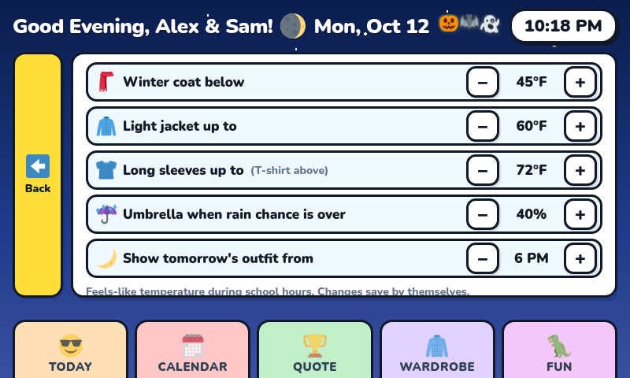

| Tile | What it does |
| --- | --- |
| **New Content** | Quotes, fun facts and jokes fetched from the internet each day wait here (the tile shows how many). Tap **Keep** (with a sticker) or **Skip**; only kept ones are shown to the kids. **Kept** lists them, ✕ takes one off again. |
| **Notes** | A note in the TODAY banner ("Library day! Bring your books"): pick a ready-made one or type your own, for today, tomorrow (from 6 PM tonight) or every day. Kept in `data/messages.json`; the kiosk checks every minute. |
| **Kids** | Names, animal buddy and clothes colour; add or remove kids (1–4). |
| **Weather Place** | Type a ZIP code → it finds the town (Open-Meteo geocoding, Zippopotam.us as a fallback) → "Use this place". Offers to switch the clock if the town is in another time zone. |
| **School** | The school calendar link (.ics / webcal; it is downloaded and checked before it's saved) and the school-day hours. |
| **What to Wear** | Coat / jacket / long-sleeve temperatures, the umbrella rain chance, and when TODAY switches to tomorrow's outfit. Saves as you tap. |
| **Bedtime** | Quiet hours: the screen goes dim, turns off a minute after the last touch, and turns itself back on at wake-up time. |
| **Screen** | Dim after / turn off after / go back to TODAY (or the idle screen) after; idle screen on/off. |
| **Date & Time** | US time zone, automatic internet time on/off, or set the date and time by hand. A new time zone restarts the kiosk browser. |
| **Wi-Fi** | Nearby networks with signal bars; tap one and type its password to join. |
| **Power** | Wi-Fi name, address, uptime, CPU temperature, free space; **Reload**, **Restart Pi**, **Power Off**. |
| **Updates** | Shows the installed version and new commits on GitHub; **Update now** runs `scripts/update.sh`. |
| **PIN** | Change the PIN. |

Everything except Notes, New Content and the PIN is saved in `config/dashboard.json`.

**One-time permission.** Restart / power off, the clock and Wi-Fi go through
systemd and NetworkManager, which need permission for the dashboard's user (a
polkit rule; until it is installed those buttons are greyed out with a note):

```sh
sudo cp system/polkit/50-kids-smart-dashboard.rules /etc/polkit-1/rules.d/
```

The rule lets user `pi` reboot, power off, set the time / time zone /
automatic time and join Wi-Fi networks without a password (edit the user name
inside if yours differs). `ADMIN_DRY_RUN=1` makes the server log those commands
instead of running them (handy for testing).

**Security.** The server also answers on the home network (so a phone can open
the Grown-ups tab), over plain HTTP. Everything that changes something needs
the PIN, except the screen controls (`/api/screen`), which only the kiosk
itself (or an unlocked Grown-ups tab) may use. Pages are sent with
anti-framing / no-sniff headers and admin replies are never cached
(`src/hooks.server.ts`). Joining Wi-Fi passes the password to `nmcli` on its
command line, visible to other local users of the Pi for a moment.

**Updates** (`scripts/update.sh`, also fine to run by hand): `git pull
--ff-only`, `npm ci` if `package-lock.json` changed, build into `build-next/`
while the old copy keeps running, swap it in (the previous one stays in
`build-old/`), then restart the server. The kiosk page checks for a new build
every minute and reloads itself once nobody is touching the screen. A checkout
with local edits is never updated from the tab (update it by hand).

## Top button

An optional push button (mounted on top of the case, say) for the things you
want without touching the screen:

| Press | What happens |
| --- | --- |
| **Tap** | Switches between the **idle screen** and **screen off**: off or dim, it wakes onto the idle screen; on the idle screen, it turns the screen off; on any other tab, it brings up the idle screen first. With the power menu open: close it |
| **Hold 2 s** | **Power menu** on the screen: Screen Off · Restart · Power Off · Cancel (closes itself after 20 s) |
| **Hold 10 s** | Restart the kiosk browser (escape hatch if the screen ever freezes) |

**Wiring.** Any *momentary, normally-open* push button with two wires. No
resistor needed (the Pi's internal pull-up is used). Connect one wire to
**pin 11 (GPIO17)** and the other to **pin 9 (GND)**, right next to each other
on the inner row of the 40-pin header:

```
 (USB ports are at the far end)          inner row  outer row
                                    3V3  (1)       (2)  5V
 Pin 1 is the end of the header   GPIO2  (3)       (4)  5V
 farthest from the USB ports,     GPIO3  (5)       (6)  GND
 on the inner row (run `pinout`   GPIO4  (7)       (8)  GPIO14
 on the Pi to see it).              GND  (9) <--+  (10) GPIO15
                                 GPIO17 (11) <--+  (12) GPIO18
                                        button between 9 and 11
```

Female-to-female jumper wires ("Dupont") push straight onto the pins, or solder
them to the button. These pins don't clash with the 7" touchscreen (its power
wires, if any, use pins 2/4 and 6). Do the wiring with the Pi unplugged.

Nothing to install: the dashboard server watches the pin with `gpiomon`
(the `pi` user is in the `gpio` group) and starts automatically. Test it by
tapping the button and watching `journalctl -u kids-smart-server -f` for
`[button] tap`. To use another pin, set `button.gpio` in `config/dashboard.json`
(BCM number) and restart the server; `"enabled": false` turns it off.

**Turning the Pi back on.** After "Power Off" a GPIO button can't wake a Pi 5:
press the Pi 5's own power button (on the board edge), or unplug and replug it.
(If you want one button for both, the Pi 5 has a separate power-button header,
J2 next to the battery connector; a button there turns the Pi on, but only does
power on/off, not the dashboard features.)

The power menu needs no PIN, since holding the button means being at the
screen, but its Restart / Power Off only work from the kiosk itself within a
minute of the hold, and need the same one-time polkit rule as the Grown-ups tab.

## Content

| File | What |
|------|------|
| `src/lib/data/quotes.json` | 100 × `{ text, author, emoji }`: real, correctly attributed quotes only (children's books, films, proverbs, scientists) |
| `src/lib/data/facts.json` | 149 × `{ text, emoji: [1-2 codes] }`: fact-checked, kid-friendly |
| `src/lib/data/jokes.json` | 147 × `{ q, a, emoji }`: question-and-answer kid jokes |
| `src/lib/data/words.json` | 107 × `{ word, say, emoji, meaning, sentence }` |
| `src/lib/data/dinos.json` | `{ name, say, means, lengthFt, diet, period, fact }` |

Each rotates once a day (`pickDaily`: days since 1970 % length, so the order
continues across New Year). Add entries freely; if you use a new emoji code,
run `npm run emoji` (see below).

So nothing repeats for months (a joke every day for almost five months), with
no upkeep.

**More from the internet, vetted by a grown-up (optional).** Once a day the Pi
fetches new candidates: quotes from [ZenQuotes](https://zenquotes.io), facts
from [Useless Facts](https://uselessfacts.jsph.pl), jokes from
[JokeAPI](https://jokeapi.dev) (safe mode) and
[icanhazdadjoke](https://icanhazdadjoke.com). None of them is written for kids
(we sampled them: heavy adult quotes, facts about gambling or poisons, jokes
about bosses, in-laws and exorcists, some plain wrong), so nothing goes on
screen by itself. Up to 30 of each wait, so checking about once a month is
plenty; if you never do, nothing breaks:

1. a filter drops anything too long or touching blocked topics
   (`kidSafe()` in `src/lib/utils/content.ts`),
2. the rest wait in **Grown-ups → New Content**, where you tap **Keep** (and
   pick a sticker) or **Skip**,
3. kept ones join the built-in lists on TODAY, QUOTE and FUN (quotes from
   ZenQuotes show a small credit, as its free API asks).

Words have no live source: the free word-of-the-day services need an account
and pick grown-up vocabulary, with no picture or kid sentence.

Everything lives in `data/content.json` (git-ignored); skipped ones are never
offered again.

## Icons

Every icon is an `` from `static/emoji/<code>.svg` (`Emoji.svelte`),
never a text emoji, and nothing is loaded from the internet. Weather
sun/cloud icons are custom comic stickers (`sun.svg`, `cloud.svg`, …); the rest
are vendored [Twemoji 14](https://github.com/twitter/twemoji) SVGs
(© Twitter, Inc and other contributors, CC-BY 4.0).

`npm run emoji` scans `src/` and `config/` for emoji codes and downloads any
missing SVG; `tests/emoji.test.ts` fails if one is missing.

## Tech stack

- **SvelteKit 3** (Svelte 5 runes, TypeScript) + **Vite** + `@sveltejs/adapter-node`
- **Pure hand-written CSS** (no Tailwind): the "sticker" theme with hard
  drop-shadows, thick dark borders and the bundled Nunito font
- **Weather:** Open-Meteo (imperial units, 7-day forecast, `/api/weather`, 5-minute server cache),
  Open-Meteo air quality (US AQI; their pollen data only covers Europe), and
  National Weather Service alerts from `api.weather.gov` (US only, free, no key)
- **Moon phase:** calculated on the Pi (no network)
- **School calendar:** district iCal feed, parsed by a small built-in reader

## Layout

```
#pi-screen  — fixed 800×480 frame, edge to edge (sky background)
├── Header      greeting + date (left), live clock pill (right)
├── main        the active page
└── nav.tabs    five flush "file-folder" tabs; active tab is coloured,
                the rest are dimmed grey and sit slightly lower
```

## Running on the Pi

Two systemd **system** services (in `systemd/`):

- `kids-smart-server.service`: `node build/index.js` on port **3000**
  (the units assume user `pi`, the app in `/home/pi/kids-smart-dashboard` and
  Node at `~/.local/share/pi-node/current/bin/node`; adjust `User=`,
  `WorkingDirectory=` and `ExecStart=` if yours differ)
- `kids-smart-kiosk.service`: `seatd`-aware `cage` compositor running
  Chromium in `--kiosk --ozone-platform=wayland` mode pointed at
  `http://localhost:3000`

Deploy steps (as root / with sudo):

```sh
cd /home/pi/kids-smart-dashboard
npm ci
cp -n config/dashboard.example.json config/dashboard.json   # first time only; then edit it
npm run build
sudo apt install cage seatd chromium        # if not already installed
sudo systemctl enable --now seatd
npm run cursor                              # hide the mouse arrow on the touch screen (see below)
sudo cp systemd/*.service /etc/systemd/system/
sudo cp system/polkit/50-kids-smart-dashboard.rules /etc/polkit-1/rules.d/   # admin tab: power + clock
sudo systemctl daemon-reload
sudo systemctl enable --now kids-smart-server kids-smart-kiosk
```

After a code change: `npm run build && sudo systemctl restart kids-smart-server kids-smart-kiosk`
(or let `scripts/update.sh` do it without the 500s: it builds beside the running copy).
**Always restart after a build:** the running server keeps old code in memory
and serves 500 errors once `build/` is replaced underneath it.

`seatd` must be running for cage to grab the panel (cage's built-in seatd
can't open `/dev/tty0|1` on this Pi). The kiosk unit sets
`SEATD_SOCKET=unix:path=/run/seatd.sock`, `XDG_RUNTIME_DIR=/run/user/1000`,
and launches `cage -s` (the `-s` flag keeps a VT escape hatch).

**No mouse arrow:** with a touch-only panel, an arrow sits in the middle of
the screen (Chromium draws it once and never updates it, since no mouse ever
moves). `npm run cursor` installs blank copies of the `default` and `Adwaita`
cursor themes in `~/.local/share/icons` for the kiosk user, which hides it
(no root needed; restart the kiosk afterwards). `node scripts/blank-cursor.mjs
--remove` brings the arrow back. In the page, the cursor stays hidden until
a real mouse is moved around, so a plugged-in mouse still works for debugging.

`start-dashboard.sh` starts the same server + kiosk by hand (same flags as the
units) for when the services are not installed.

Useful operations:

```sh
sudo systemctl status kids-smart-server kids-smart-kiosk
sudo journalctl -u kids-smart-server -f     # [weather] / [school] / [config] warnings show up here
sudo systemctl restart kids-smart-server kids-smart-kiosk
```

## Development

```sh
npm install
npm run dev       # dev server on http://localhost:5173
npm run check     # svelte-check (should report 0 errors, 0 warnings)
npm run test      # vitest (plain Node, ~2 s): calendar/feed, wardrobe, weather, config, screen,
                  # admin (PIN, settings), notes, live content filter, icons...
npm run build     # production build → build/index.js
npm run emoji     # vendor any newly referenced Twemoji SVGs
npm run cursor    # (on the Pi) hide the kiosk's mouse arrow
```

Headless screenshots for layout checks (the panel framebuffer is owned by
cage/DRM, so check against a second server instead). Use
`BACKLIGHT_DIR` pointing at a scratch folder (with `panel/brightness` and
`panel/max_brightness` files) so a test server doesn't change the real screen:

Add `ADMIN_DRY_RUN=1` (log power/clock/Wi-Fi commands instead of running
them) and a scratch `DASHBOARD_CONFIG` / `DASHBOARD_DATA` when testing the
Grown-ups tab.

```sh
BACKLIGHT_DIR=/tmp/fakebl PORT=3001 nohup ~/.local/share/pi-node/current/bin/node build/index.js &
chromium --headless=new --no-sandbox --disable-gpu \
  --window-size=800,480 --force-device-scale-factor=1 --hide-scrollbars \
  --virtual-time-budget=8000 --screenshot=/tmp/today.png http://localhost:3001/
```

## Source map

```
config/
├── dashboard.example.json   template settings (committed)
└── dashboard.json           your settings (git-ignored)
docs/screenshots/            README screenshots (taken with the example config)
src/
├── app.css                  the whole sticker theme (frame, header, cards, tabs)
├── lib/
│   ├── config.ts            config shape, defaults, validation
│   ├── clock.ts             shared ticking clock + todayKey (midnight rollover)
│   ├── weather.ts           shared self-refreshing weather store
│   ├── report.ts            open/close state of the full weather report
│   ├── screen.ts            idle dim/off rules + brightness panel state
│   ├── sky.ts               time-of-day background phase
│   ├── themes.ts            US + Indian festival themes (decorations, greetings, hats, countdown)
│   ├── place.ts             where the dashboard is (for the panchang)
│   ├── buddies.ts           animal buddy list + default clothes colours
│   ├── components/          Emoji, Buddy (dressed animal SVG), KidAvatar, Header, BottomNav,
│   │                        SectionTitle, WeatherReport, WeatherIcon, IdleScreen, FestiveTrim, ScreenControl, Keypad, PowerMenu
│   │   └── admin/           one *Section per admin tile, TextSheet (on-screen keyboard), Stepper
│   ├── admin.svelte.ts      the admin page's session (API calls, notes, lock)
│   ├── messages.ts          grown-up notes store (polled every minute)
│   ├── data/                quotes, facts, dinos, jokes, words, school-calendar.seed.ics
│   ├── server/              config loader/writer, TTL cache, school feed, backlight control,
│   │                        admin PIN + sessions, ZIP geocoding, notes, live quotes/facts,
│   │                        system (power/clock/Wi-Fi/health/updates), top button (GPIO)
│   └── utils/               ics, schoolCalendar, wardrobe, weatherCodes, time, dino,
│                            forecastStory (story/air/alerts), moon, mathPuzzle, admin, messages, content,
│                            panchang (Marathi calendar: tithi, months, festivals)
└── routes/
    ├── +layout.server.ts    config + school events for every page
    ├── +layout.svelte       frame, header, nav, polling, idle return, screen dim/off/wake
    ├── +page.svelte         TODAY
    ├── calendar/ quote/ wardrobe/ fun/
    ├── admin/               Grown-ups tab (PIN gate + tiles)
    ├── api/weather/         Open-Meteo proxy (typed, cached, stale fallback)
    ├── api/screen/          backlight on/dim/off + brightness
    ├── api/messages/        grown-up notes for the TODAY banner
    ├── api/button/          top-button gestures (server-sent events) + power menu
    └── api/admin/           admin: login, settings, zip, time, power, pin, messages, wifi, update, content
scripts/                     emoji vendoring, blank kiosk cursor, update.sh
tests/                       vitest suites
systemd/                     kids-smart-server.service, kids-smart-kiosk.service
system/polkit/               rule letting the dashboard restart/power off, set the clock, join Wi-Fi
sample-pages/                the original HTML mockups (design reference)
```

## License

[Apache License 2.0](LICENSE). Twemoji graphics in `static/emoji` are
© Twitter, Inc and other contributors, licensed CC-BY 4.0.
